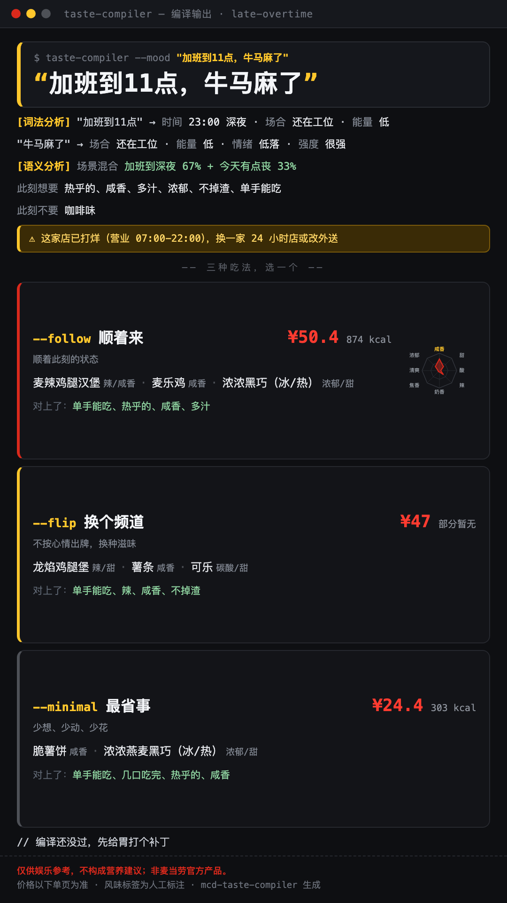

# 味觉编译器 · mcd-taste-compiler

> "今晚吃什么"这个千古难题，不该让你在麦当劳小程序里翻三分钟菜单。
> 丢过来一句话——"加班到11点牛马麻了"、"热化了🥵"、"周一早八困成狗"——它把你此刻的状态编译成这家门店**现在真能点到的**风味组合：真实价格、真实热量、一张能直接发群的编译卡片。

```
$ taste-compiler --mood "加班到11点，牛马麻了"

[词法分析]  "加班到11点"  → 时间：23:00 深夜 · 场合：还在工位 · 能量：低
            "牛马麻了"  → 场合：还在工位 · 能量：低 · 情绪：低落 · 强度：很强
[语义分析]  此刻想要：热乎的、咸香、多汁、浓郁、不掉渣、单手能吃
            此刻不要：咖啡味
[链接]      加班到深夜 67% + 今天有点丧 33%
            深夜有 3 种处理方式，选一个 ↓

 ▸ --follow   顺着来：顺着此刻的状态
   麦辣鸡腿汉堡 + 麦乐鸡 + 浓浓黑巧（冰/热）
   ¥50.4 · 874 kcal · 对上了：单手能吃、热乎的、咸香、多汁

 ▸ --flip     换个频道：不按心情出牌，换种滋味
   龙焰鸡腿堡 + 薯条 + 可乐
   ¥47 · 热量部分暂无 · 对上了：单手能吃、辣、咸香、不掉渣

 ▸ --minimal  最省事：少想、少动、少花
   脆薯饼 + 浓浓燕麦黑巧（冰/热）
   ¥24.4 · 303 kcal · 对上了：单手能吃、几口吃完、热乎的、咸香

⚠ 这家店已打烊（营业 07:00-22:00），换一家 24 小时店或改外送
// 编译还没过，先给胃打个补丁
// 价格以下单页为准；仅供娱乐参考，不构成营养建议
```

编译结果长这样（`scripts/card.py` 一键生成，竖版 9:16，截图即分享）：



## 它做什么

- **听得懂人话，尤其是网络用语**：260+ 词条、emoji 和拼音缩写（emo、破防、牛马、蚌埠住、热死、饿醒、🫠、yyds……）映射到 14 个场景，命中即编译
- **先把你的话拆开看**：词法分析逐句解读（时间/场合/情绪/强度），多个状态加权混合成"此刻需求"，每一步都摆在明面上
- **只推荐点得到的**：候选来自门店实时菜单（麦当劳 MCP `query-meals`），早餐/夜市/下午茶时段自动切换——深夜给你的绝不是早餐套餐
- **价格是真的**：每套方案调用 `calculate-price` 算出应付价，不是菜单价目表的"仅供参考"
- **三种处理方式**：`--follow` 顺着来 / `--flip` 换个频道 / `--minimal` 最省事，每个单品都给"对上了"的理由，14 个场景的"换个频道"互不重样
- **风味可视化**：79 个单品的口感/温度/味型标签，生成 8 轴风味雷达
- **一键出分享卡片**：你的原话当主角 + 编译日志式解读 + 三种策略的 9:16 HTML 卡片（`scripts/card.py`，零依赖）
- **确认后可下单**：说"就这个"，复述确认后调用 `create-order` 返回支付链接
- **该闭嘴时闭嘴**：识别到轻生相关的表达，直接停止推荐，给出心理援助热线——编译器管吃饭，不管"替你消化情绪"

## 目标用户

不知道吃什么、懒得翻菜单的打工人和学生；想把点餐变成一点小乐趣、顺便发个朋友圈的人。

## 30 秒上手

### 1. 申请 MCP Token

登录 [open.mcd.cn/mcp](https://open.mcd.cn/mcp) → 控制台 → 激活，复制 Token。

### 2. 配置 MCP 连接器

把 [`mcp-config.example.json`](./mcp-config.example.json) 加到你的 MCP 客户端（WorkBuddy / Claude Code / Cursor 等），将 `${MCD_MCP_TOKEN}` 替换为你的 Token。

### 3. 安装 Skill

```bash
git clone https://github.com/FKDKCSJ/mcd-taste-compiler
# WorkBuddy
ln -s "$PWD/mcd-taste-compiler" ~/.workbuddy/skills/mcd-taste-compiler
# Claude Code
ln -s "$PWD/mcd-taste-compiler" ~/.claude/skills/mcd-taste-compiler
```

### 4. 命令行直接用（可选）

只需 Python 3.8+，无第三方依赖：

```bash
export MCD_MCP_TOKEN=你的Token
python3 scripts/compile.py --mood "今天emo了" --store <storeCode>

# 把结果渲染成 9:16 分享卡片
python3 scripts/compile.py --mood "今天emo了" --store <storeCode> --format json > out/result.json
python3 scripts/card.py out/result.json --mood "今天emo了" -o out/card.html
```

## 使用示例

在 Agent 里直接说：

- "加班到现在，牛马麻了，国贸附近"
- "热死了，想吃点冰的"
- "周末带娃，在望京"
- "凌晨饿醒了"

## 场景一览

| 场景 | 典型说法 |
|---|---|
| 加班到深夜 | 加班、牛马、996、修仙 |
| 周一早上起不来 | 周一、早八、困成狗 |
| 刚考完试 / 刚上线 | 考完、发版、狂喜 |
| 下雨不想出门 | 下雨、宅家、降温 |
| 热到不想动 | 热死、化了 |
| 想吃点刺激的 | 嘴里没味、上头 |
| 下午有点饿 | 嘴巴寂寞、垫一口 |
| 刚运动完 | 撸铁、跑完 |
| 和朋友一起 | 开黑、团建 |
| 今天有点丧 | emo、破防、麻了、蚌埠住 |
| 约会 | 约会、见网友 |
| 带娃 | 遛娃、神兽 |
| 凌晨饿醒 | 半夜、睡不着 |

## 项目结构

```
SKILL.md                 Agent 使用说明
scripts/compile.py       编译引擎（只调用只读 MCP 工具）
scripts/card.py          9:16 分享卡片渲染（HTML + 内联 SVG，零依赖）
data/flavor-tags.json    单品风味标签 + 营养名称映射
data/scenes.json         场景 → 风味向量
data/slang.json          网络用语 → 场景（含 emoji / 拼音缩写 / 危机词表）
docs/card.png            卡片示例截图
MCP_INTEGRATION.md       MCP 工具与调用流程
```

## 声明

本项目为麦当劳程序员节创意开发大赛参赛作品，由参赛者独立开发，非麦当劳官方产品。输出仅供娱乐参考，不构成医疗、营养或其他专业建议；餐品信息、价格及供应状态以麦当劳官方渠道实时结果为准。详见 [CONTEST_DECLARATION.md](./CONTEST_DECLARATION.md)。
